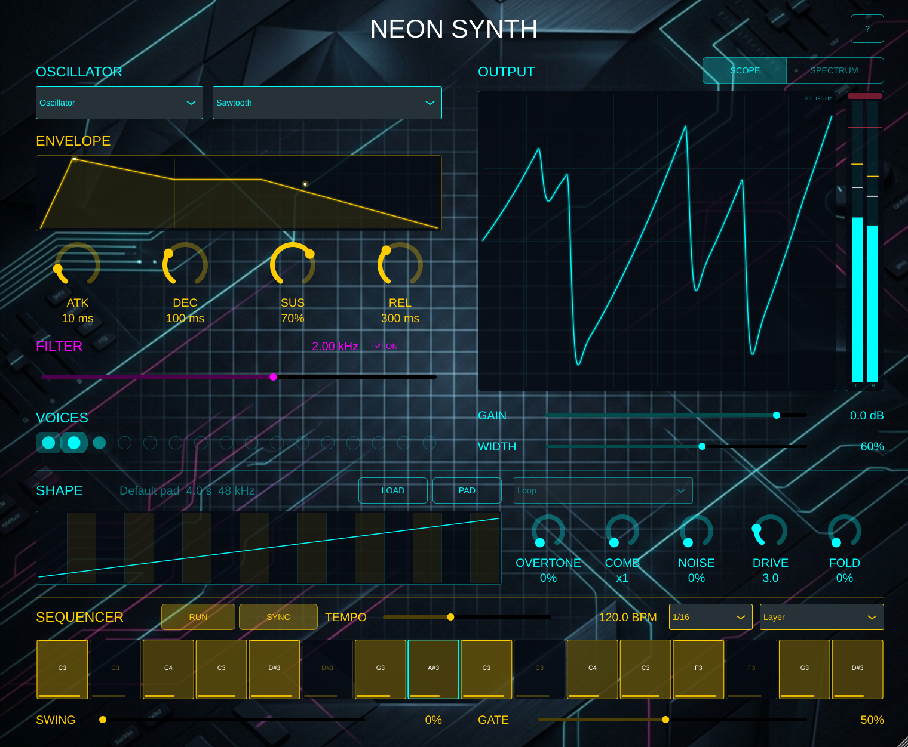

# Neon Synth

[](https://github.com/kv244/Synth/actions/workflows/test.yml)
[](https://github.com/kv244/Synth/actions/workflows/build.yml)
[](https://github.com/kv244/Synth/actions/workflows/lint.yml)
[](https://github.com/kv244/Synth/actions/workflows/release.yml)
[](https://github.com/kv244/Synth/releases/latest)

A futuristic, neon-styled virtual analog synthesizer built with JUCE and C++17,
by **Razvan Julian Petrescu** / **AudioDSP**.

NeonSynth is a learning synthesizer for musicians and coders: every control shows what it does to the sound,
and the **[user manual](docs/NeonSynth-User-Manual.md)** teaches it by ear and maps it to the C++ source.



**[If you want to hear it in action](docs/demo/neonsynth-demo.wav)**: a 33-second piece (WAV, 6 MB) in which every
sound is NeonSynth. Six instances play together: a granular pad, a Random-source bass through CHOP and the
wavefolder, a chopped sawtooth arpeggio, the built-in step sequencer with swing, noise hats and a looped-sample
lead. [`docs/demo/make_demo.py`](docs/demo/make_demo.py) renders it from the VST3.

## Highlights

- **Four sound sources**: a band-limited oscillator (sine, square, triangle, sawtooth), your own sample,
  a granular cloud of that sample, and Random, a pitched wave of 16 drifting steps.
- **Waveform sculpting**: CHOP cuts or flips steps of every cycle (after the Roland S-1), NOISE fades the
  wave into white noise, and FOLD folds it back on itself.
- **Envelope, filter and output**: an ADSR you can drag on its own graph, a low-pass filter, 16 voices panned
  by pitch, and a soft clipper that keeps the output under −1 dBFS.
- **16-step sequencer**: sample-accurate, synced to the DAW or its own tempo, with swing, gate and three
  keyboard modes.
- **You see what you hear**: oscilloscope, spectrum with the filter curve, envelope with a dot per voice,
  voice lights and a stereo meter, in a window that scales from 75% to 150%.
- **Sessions keep everything**: the sample, the sequencer pattern and the CHOP pattern are saved with the
  DAW project, and every parameter can be automated.

The **[user manual](docs/NeonSynth-User-Manual.md)** explains every control, with listening exercises,
sound-design starting points, troubleshooting and a tour of the C++ source. Each release also carries it
as a PDF.

## Installation

Windows 10 or 11, 64-bit. Download `NeonSynth-x.y.z-Windows-Setup.exe` from the
**[latest release](https://github.com/kv244/Synth/releases/latest)** and run it.

| Installed | Where |
|---|---|
| VST3 instrument | `C:\Program Files\Common Files\VST3\NeonSynth.vst3` |
| Standalone application (optional) | `C:\Program Files\AudioDSP\Neon Synth\NeonSynth.exe` |

In a DAW, rescan your VST3 plugins and look for **NeonSynth** under the manufacturer **AudioDSP**. In the
Standalone, choose your audio output and MIDI input under **Options → Audio/MIDI Settings**; with no MIDI
keyboard, press **RUN** and the sequencer plays. The installer is not code-signed yet, so Windows SmartScreen
may ask you to confirm. The manual's first chapters cover setup in detail.

## Building

You need CMake 3.21 or newer, a C++17 compiler (MSVC 2022, Clang or GCC) and
[JUCE 9.0.0](https://github.com/juce-framework/JUCE/releases/tag/9.0.0), downloaded separately.

```bash
cmake -S . -B build -DJUCE_DIR="/path/to/JUCE" -DCMAKE_BUILD_TYPE=Release
cmake --build build --config Release
```

The VST3 and the Standalone land in `build/NeonSynth_artefacts/Release/`. The
**[developer notes](docs/DEVELOPMENT.md)** cover the unit tests, the Python test suite, the benchmark,
MIDI logging and the layout of the source.

## Release history

| Version | Date | What changed |
|---|---|---|
| [v1.7.0](https://github.com/kv244/Synth/releases/tag/v1.7.0) | 12 Nov 2026 | A new 1280 × 860 window that scales from 75% to 150%; the envelope's four points can be dragged on its graph; Esc closes the help page from any control |
| [v1.6.0](https://github.com/kv244/Synth/releases/tag/v1.6.0) | 11 Nov 2026 | Waveform sculpting: CHOP, Noise and Fold, with the SHAPE strip; cleaner band-limited oscillators; the illustrated manual and its PDF |
| [v1.5.0](https://github.com/kv244/Synth/releases/tag/v1.5.0) | 5 Nov 2026 | Sample, Granular and Random sources; the sample is saved inside the session |
| [v1.4.0](https://github.com/kv244/Synth/releases/tag/v1.4.0) | 5 Nov 2026 | Hardening: sample-accurate notes, the output soft clipper, a new envelope, no stuck notes. Renamed from BasicSynth to NeonSynth (old projects still open); licence changed from MIT to AGPLv3 |
| [v1.3.0](https://github.com/kv244/Synth/releases/tag/v1.3.0) | 4 Nov 2026 | The 16-step sequencer |
| [v1.2.0](https://github.com/kv244/Synth/releases/tag/v1.2.0) | 3 Nov 2026 | Visualisers, stereo width, a resizable window |
| [v1.1.0](https://github.com/kv244/Synth/releases/tag/v1.1.0) | 3 Nov 2026 | Real-time safety, JUCE 9, a rewritten voice |
| [v1.0.1](https://github.com/kv244/Synth/releases/tag/v1.0.1) | 21 Jun 2026 | Licence file, CI and README badges |
| [v1.0.0](https://github.com/kv244/Synth/releases/tag/v1.0.0) | 2 Jun 2026 | First release: four waveforms, a low-pass filter, 8 voices |

## JUCE or Qt for the GUI

JUCE and Qt are both C++ frameworks that can draw a window, but they are built for different jobs. JUCE is an
audio framework that includes a GUI; Qt is a general application framework with no audio-plugin support.
NeonSynth uses JUCE. This section says when each one is the right choice and why NeonSynth chose as it did.
It compares JUCE 9.0.0, which NeonSynth builds with, and Qt 6.12, the current Qt release in November 2026.

### When JUCE is the right choice

- **Audio plugins** (VST3, AU, AAX, LV2) whose window opens inside a DAW. The host embeds the editor, and JUCE
  is designed for exactly that.
- **Standalone audio programs** where the sound engine and the window are one codebase: synths, effects,
  tuners, small recorders.
- **Custom-drawn, single-window interfaces**: knobs, meters, scopes, waveforms. JUCE gives a canvas and a few
  audio-minded controls and expects you to draw the rest.
- **Controls that must be automatable.** JUCE ties a knob to a plugin parameter, including the begin and end
  of a drag that a DAW records.
- **One dependency, one file to ship.** JUCE compiles into the binary; there is nothing else to install.

### When Qt is the right choice

- **General desktop applications** with many standard parts: forms, tables, trees, docking panels, menus,
  several windows, rich text. Qt's widget set is large and mature; JUCE's is small.
- **Data-heavy interfaces**: lists and tables backed by models, databases, file browsers.
- **Designer-led or declarative interfaces.** QML, Qt Designer and Qt Design Studio let a designer build and
  animate the UI; JUCE's UI is C++ code.
- **Touch screens and embedded devices**: instrument panels, kiosks, the screen of a hardware unit.
- **Wide reach**: strong accessibility, translation tooling, right-to-left text and input methods.
- **Programs where audio is one feature among many.** Qt handles the application, and a separate audio
  library handles the sound.

### Where they overlap

A standalone audio application can go either way. Large ones with many windows and lists (a DAW, a sample
librarian) lean to Qt with a separate audio engine; instrument-like ones lean to JUCE. A plugin window in Qt
is possible but uncommon: Qt expects to own the application object and the event loop, a plugin is a guest in
the host's process, and the bridge between the two is yours to write and maintain.

### The decision for NeonSynth: JUCE

1. **It is a plugin first.** NeonSynth ships as a VST3 with a Standalone beside it. JUCE provides the plugin
   format, the audio thread and the window from one codebase, and the window behaves correctly inside a host.
2. **Every control is a parameter.** Knobs, switches and choices are attached to automatable parameters;
   the editor tests check that each drag reaches the host as one gesture.
3. **The interface is drawn by hand.** The scope, spectrum, envelope, sample view and step grid are all custom
   paint code. Qt's main advantage, its ready-made widgets, would go unused.
4. **It ships as one file.** JUCE is compiled in, so the installer copies a `.vst3` and an `.exe` and nothing
   else. Qt would add its libraries next to the plugin, in a folder shared with other plugins.
5. **The licence matches.** JUCE is available under AGPLv3, which is NeonSynth's own licence.

What this costs: no visual designer, no layout managers beyond FlexBox and Grid (NeonSynth lays everything out
on a fixed 1280 x 860 grid and scales it), and thinner accessibility than Qt offers. Qt would be the better
choice for a standalone companion tool built from standard widgets, such as a preset librarian.

### At a glance

| | JUCE 9 GUI | Qt 6 |
|---|---|---|
| Made for | Audio plugins and audio programs | General applications, desktop to embedded |
| Window inside a DAW | Built in | Not designed for it |
| Automatable parameters | Built in (attachments) | You write the binding |
| Ready-made widgets | Few, audio-minded | Many, mature |
| Design tools | None; C++ (or HTML in a WebView) | QML, Qt Designer, Qt Design Studio |
| Rendering | Own 2D renderer (Direct2D, CoreGraphics, software; OpenGL optional) | Software for Widgets; GPU for Qt Quick |
| Shipping | Compiled in, one file | Libraries shipped alongside |
| Licence | AGPLv3 or commercial | LGPLv3 for most modules, GPLv3 for some, or commercial |

Sources: [JUCE 9 announcement](https://forum.juce.com/t/juce-9-is-available-now/69175), JUCE 9.0.0's
`CHANGE_LIST.md` and `LICENSE.md`, [Qt licensing](https://doc.qt.io/qt-6/licensing.html). Licence terms change;
check the linked pages before relying on them.

## License

Copyright (C) 2026 Razvan Julian Petrescu. Portions assisted by Claude (Anthropic).

NeonSynth is free software: you can redistribute it and/or modify it under the terms of the
[GNU Affero General Public License version 3](LICENSE) (AGPL-3.0-only), as published by the Free
Software Foundation. It is distributed in the hope that it will be useful, but WITHOUT ANY
WARRANTY; without even the implied warranty of MERCHANTABILITY or FITNESS FOR A PARTICULAR PURPOSE.
See the license for details.

NeonSynth is built on [JUCE](https://juce.com), which it uses under JUCE's AGPLv3 option. If you
distribute NeonSynth, or software built from it, you must make the complete corresponding source
available under the same license; this repository is that source for the official releases.

Releases up to and including v1.3.0 were published under the MIT license; from v1.4.0 the project
is licensed under the AGPLv3.
