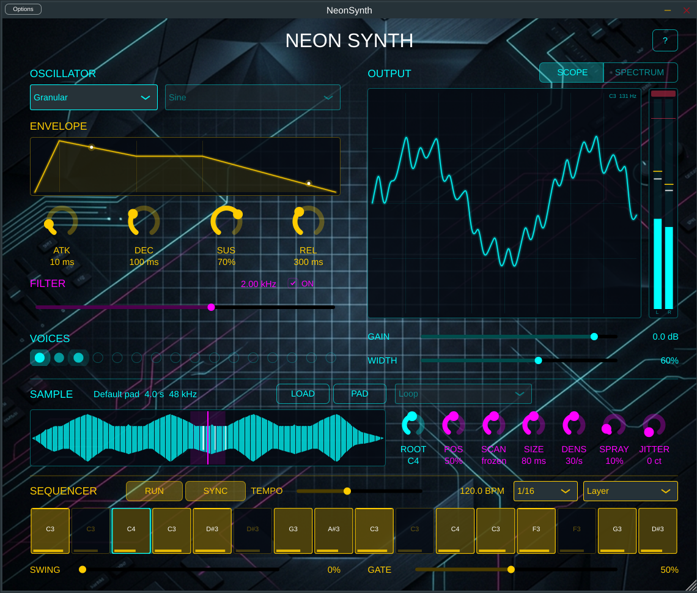

# Neon Synth

[](https://github.com/kv244/Synth/actions/workflows/test.yml)
[](https://github.com/kv244/Synth/actions/workflows/build.yml)
[](https://github.com/kv244/Synth/actions/workflows/lint.yml)
[](https://github.com/kv244/Synth/actions/workflows/release.yml)
[](https://github.com/kv244/Synth/releases/latest)

A futuristic, neon-styled virtual analog synthesizer built with JUCE and C++17,
by **Razvan Julian Petrescu** / **AudioDSP**.



## Features

- **4 Waveforms** — Sine, Square, Triangle, Sawtooth
- **Random** — a pitched wave of 16 random steps per cycle; one step is re-rolled about every cycle, so it keeps its pitch while its timbre drifts (the whole shape is renewed every 17 cycles). Band-limited and seeded, so the same MIDI renders the same audio
- **Granular** — a cloud of up to 32 short grains per voice from the same sample: position, scan (moving through the file at up to ±2× its speed, or frozen), grain size, density, spray and pitch jitter; seeded, so the same MIDI renders the same audio
- **Sample playback** — load a WAV, AIFF or FLAC file (or drop it on the window) and play it across the keyboard: root note, start point, One-shot / Loop / Loop until release with a crossfaded loop, and band-limited copies so high notes don't alias. A built-in pad plays until you load a file, and the sample is saved inside the session
- **Low-pass Filter** — adjustable cutoff (20 Hz – 20 kHz) with on/off bypass toggle
- **16-voice Polyphony** — up to 16 simultaneous notes, with click-free voice stealing
- **ADSR envelope** — linear segments whose durations match the knob values; Sustain changes glide (10 ms) instead of stepping, and a release always takes the Release time, whenever the note is let go
- **Band-limited oscillators** — PolyBLEP square and sawtooth to reduce aliasing
- **Output gain** — host-automatable output level (−48 dB to +6 dB)
- **Headroom protection** — an output soft clipper, untouched below −6 dBFS, keeps even 16 full-velocity voices under −1 dBFS
- **Stereo width** — voices are panned by pitch (middle C centred, two octaves either side at the edges); 0% is mono, 100% full spread
- **Visualisers** — triggered oscilloscope locked to the lowest held note, spectrum analyser with the live filter curve, ADSR shape with a dot per sounding voice, 16 voice lights and an L/R output meter with peak hold and clip light
- **16-step sequencer** — sample-accurate end to end, synced to the host transport or its own tempo, with swing, gate, five step rates and three keyboard modes (Layer / Replace / Transpose); the pattern is saved with the session
- **Custom neon GUI** — background image, cyan/magenta/amber controls; resizable from 75% to 200%; a **?** button opens quick help
- **MIDI** — works with any MIDI controller or keyboard
- **MIDI Logging** — optional, real-time-safe logging of received MIDI messages to a file (`NEONSYNTH_MIDILOG=<file>`, or `--midilog <file>` in the Standalone)
- **DAW automation** — all parameters are automatable in VST3 hosts

---

## User manual: learn by listening, explore the code

The **[NeonSynth User Manual](docs/NeonSynth-User-Manual.md)** positions NeonSynth
as a learning synthesizer for musicians and coders. For musicians, guided
listening exercises compare individual waveforms before introducing filtering,
envelopes, sample playback and granular synthesis. Each oscillator voice starts
with one selected waveform, keeping the comparison clear; the instrument still
supports 16-note polyphony.

For coders, the manual maps the controls and signal path to the C++ source,
with a suggested reading path and small, testable experiments. It also covers
installation, sequencing, session saving, sound-design starting points and
troubleshooting.

---

## Download

Pre-built Windows installer: **[Latest release →](https://github.com/kv244/Synth/releases/latest)**

Run `NeonSynth-x.y.z-Windows-Setup.exe`. The wizard installs the VST3 to
`C:\Program Files\Common Files\VST3\` and optionally the standalone app to
`C:\Program Files\AudioDSP\Neon Synth\`.

---

## Releasing

Releases are published only from a version tag; merging to `master` publishes nothing.

1. Set the new version in `CMakeLists.txt` (both places) and `installer.nsi`, and merge it to `master`.
2. Tag it: `git tag v1.5.0 && git push origin v1.5.0`.

The Release workflow refuses a tag that doesn't match `CMakeLists.txt`, or one that already has a release, then runs every test and pluginval at strictness 10 before building the installer.

---

## Building

### Prerequisites

| Tool | Version |
|---|---|
| CMake | 3.21+ |
| JUCE | 9.0.0 (download separately) |
| C++ compiler | MSVC 2022 / Clang / GCC with C++17 |

### Steps

```bash
cmake -S . -B build \
      -DJUCE_DIR="/path/to/JUCE" \
      -DCMAKE_BUILD_TYPE=Release

cmake --build build --config Release
```

On Windows (PowerShell):

```powershell
cmake -S . -B build `
      -DJUCE_DIR="C:/path/to/JUCE" `
      -DCMAKE_BUILD_TYPE=Release

cmake --build build --config Release
```

### Build outputs

| Format | Path |
|---|---|
| Standalone | `build/NeonSynth_artefacts/Release/Standalone/NeonSynth.exe` |
| VST3 | `build/NeonSynth_artefacts/Release/VST3/NeonSynth.vst3/` |

---

## Usage

### Standalone

Run `NeonSynth.exe`. Click **Options → Audio/MIDI Settings** to select your
audio output and MIDI input device, then play from any connected MIDI keyboard.

**No MIDI keyboard?** Press **RUN** — the step sequencer plays its pattern on its own. To play notes, use a virtual keyboard such as [VMPK](https://vmpk.sourceforge.io/) routed through [loopMIDI](https://www.tobias-erichsen.de/software/loopmidi.html), then tick the loopMIDI port under MIDI inputs.

**No sound?** Check that the output device is selected and its channels are ticked under *Active output channels*. Laptop speakers reproduce very little below about 200 Hz, so low notes on the Sine or Triangle waveform can be almost inaudible — switch to Sawtooth or Square, raise the notes, or use headphones. The **?** button in the top-right corner has these tips too.

You can also launch the standalone application with the `--midilog <file>` parameter, or set the `NEONSYNTH_MIDILOG` environment variable, to log real-time MIDI input:
```bash
NeonSynth.exe --midilog log.txt
```

### VST3

Copy the `NeonSynth.vst3` bundle to your DAW's VST3 folder
(typically `C:\Program Files\Common Files\VST3\`). The plugin appears under
the **AudioDSP** manufacturer in your DAW's instrument browser.

### Controls

| Control | Colour | Description |
|---|---|---|
| Source | Cyan | What the voices play — Oscillator (the Waveform below), Sample, Granular (grains of the sample), or Random (a pitched, evolving wave of 16 random steps) |
| Waveform | Cyan | Oscillator shape — Sine / Square / Triangle / Sawtooth (dimmed when Source isn't Oscillator) |
| LOAD / PAD | Cyan | Load a WAV, AIFF or FLAC file (or drop one anywhere on the window); PAD returns to the built-in pad. The file name, its length and its sample rate (for example `pad.wav  2.5 s  44.1 kHz`) and any loading problem are shown beside them; a long name is shortened, and the tooltip shows the full path |
| Loop mode | Cyan | One-shot plays to the end; Loop loops while the note sounds (release included); Loop until release loops while the key is held, then plays on to the end |
| Sample view | Cyan | The waveform with the start (cyan line), the loop (amber brackets) and a white playhead per sounding voice; drag a marker to move it, click to set the start |
| ROOT / START / L.START / L.END / XFADE | Cyan | Root key (plays the file at its own pitch), start point, loop start and end, and the loop crossfade (5–50 ms) |
| ROOT / POS / SCAN / SIZE / DENS / SPRAY / JITTER | Magenta | With Source = Granular the knob row changes: position of the cloud (also draggable on the waveform), scan speed (−2× to +2×, 0 freezes), grain size (5–500 ms), density (1–200 grains/s), spray (how far grains scatter from the position) and pitch jitter (0–100 cents). The waveform then shows the position, the spray band and a tick per sounding grain |
| ATK / DEC / SUS / REL | Amber | Envelope knobs, with their values shown underneath; the graph above them draws the shape and a dot for every sounding voice |
| Filter ON | Magenta | Toggle button — enables / bypasses the filter (dims the cutoff slider when off) |
| Cutoff | Magenta | Low-pass filter cutoff frequency (20 Hz – 20 kHz) |
| Voices | Cyan | One light per voice; brightness follows that voice's envelope |
| Scope / Spectrum | Cyan | Output display: an oscilloscope locked to the lowest held note, or a spectrum with the filter's response curve drawn on top |
| Meter | Cyan | Left / right output level with peak hold; the red light shows the output soft clipper working near its −1 dBFS ceiling (click the meter to reset) |
| Gain | Cyan | Output level, −48 dB to +6 dB |
| Width | Cyan | Stereo spread of voices by pitch, 0–100% |
| ? | Cyan | Quick help drawn over the window — sequencer editing, modes, controls and no-sound tips. Click anywhere or press Esc to close |

---

## Step Sequencer

A 16-step sequencer sits along the bottom of the window. It is **off by default**: press **RUN** to start it.

| Control | Description |
|---|---|
| RUN | Starts / stops the sequencer (lit amber while running). Stopping releases any sounding notes at once. |
| SYNC | Lit = on. On: follow the host's tempo and transport (the pattern locks to the DAW's bars and stops when the DAW stops). The readout then shows `HOST` and the host tempo. If the host has no transport — e.g. the Standalone — the sequencer uses TEMPO instead. Off: always use TEMPO. |
| TEMPO | Internal tempo, 40–240 BPM. |
| Rate | Step length: 1/8, 1/16, 1/32, 1/8T or 1/16T. |
| Mode | **Layer** — sequencer and keyboard both play. **Replace** — keyboard notes are ignored. **Transpose** — the pattern plays only while a key is held, shifted by (key − C4); the most recently pressed key wins. |
| Step grid | Click a step to switch it on/off. Drag up/down to change its note, shift-drag (or right-drag) to change its velocity; the mouse wheel nudges the note (with shift, the velocity). The cyan outline is the playhead; brighter top edges mark the beats. |
| SWING | Delays every odd step by up to half a step (about 33% gives a triplet feel). |
| GATE | Note length as a fraction of a step, 5–100%. |

Notes on behaviour:

- Every step is placed on an exact sample, derived from the transport each block, so timing does not drift and does not depend on the host's buffer size. The synth also starts every note on its exact sample (it renders up to each MIDI event rather than in 32-sample chunks).
- Small irregularities in the host's beat position — a tempo change inside a block, rounding — of up to 2 ms are treated as continuous playback; only a real jump (a loop or locate) releases held notes.
- With SYNC on in a DAW, the sequencer follows the DAW's transport: press play in the DAW to hear it.
- The sequencer and the keyboard never cut off each other's notes, even on the same pitch: the sequencer plays on its own MIDI channel, and keyboard input is moved to channel 1 whatever channel it arrives on.
- The pattern (16 × on / note / velocity) is saved in the plugin state with the session and presets. Sessions saved with earlier versions load with the default pattern.
- The engine is `StepSequencer.h`; it depends only on `juce_audio_basics` and is covered by its own unit tests (`tests/StepSequencerTests.cpp`, see [Unit tests and benchmark](#unit-tests-and-benchmark)).

---

## Upgrading from BasicSynth

Before v1.4 the plugin was called **BasicSynth**. It is now **NeonSynth** (`NeonSynth.vst3`, `NeonSynth.exe`). The plugin's internal ID is unchanged, so DAW projects saved with BasicSynth open with NeonSynth and keep their settings. The installer removes the old `BasicSynth.vst3` so your DAW doesn't list the plugin twice. The Standalone now stores its settings under the new name, so pick your audio and MIDI devices once more in **Options → Audio/MIDI Settings**. The `BASICSYNTH_MIDILOG` environment variable still works; `NEONSYNTH_MIDILOG` is the new name.

---

## Unit tests and benchmark

Configure with `-DNEONSYNTH_BUILD_TESTS=ON` to add the unit tests and the benchmark. `ctest` runs every unit test:

```bash
cmake -S . -B build -DJUCE_DIR="/path/to/JUCE" -DNEONSYNTH_BUILD_TESTS=ON
cmake --build build --config Release --target unit_tests RenderBenchmark
ctest --test-dir build -C Release --output-on-failure
```

| Program | What it checks |
|---|---|
| `StepSequencerTests` | Sequencer timing, gate, swing, rates, block-size independence, stop and loop handling, tolerance of small transport drift, triggers disabled, retriggering, step packing (15 checks) |
| `VoiceEnvelopeTests` | The voice envelope: identical to `juce::ADSR` with fixed settings, releases that survive parameter updates, sustain slew, retriggering, release-time changes (6 checks) |
| `OscillatorTests` | The oscillators: pitch and DC offset of every waveform, level at high pitch, band-limited saw step, waveform changes waiting for the cycle boundary, phase kept across pitch changes; the Random source's repeatability, range, step statistics (one level replaced per cycle), pitch, and band-limited steps (27 checks) |
| `SampleDataTests` | The sample: mono mix, −1 dBFS normalisation, 24-bit grid, 60 s cap, decimated copies (pitch kept, aliasing removed), exact FLAC round trip, file loading, the built-in pad, and the lock-free hand-off freeing replaced samples only when safe, including 2000 swaps under load (39 checks) |
| `SampleReaderTests` | Sample playback: pitch tracking (and across sample rates), which band-limited copy each pitch reads, no aliasing at +24 semitones, steady level through crossfaded loops, smooth off-cycle loops, One-shot ends, Loop until release, start offset, the sample reference count (23 checks) |
| `GranularTests` | The granular source: bit-identical renders from the same seed, grain counts at 5 / 50 / 200 per second, steady level across size and density, pitch, the 32-grain cap, scan speed and freeze, retrigger without cutting grains, stopping, the sample reference |
| `RealtimeSafetyTests` | Hooks `operator new`/`delete` and fails if `processBlock` allocates or frees while rendering chords, the sequencer, every waveform and every source as another thread keeps replacing the sample |
| `RenderBenchmark` | Times `processBlock` directly (no host) for idle, one note, 16 voices, 16 voices on each of the Sample, Random and Granular sources, and a dense sequencer + chords load |

### Performance

`RenderBenchmark` on the development machine, 48 kHz with 512-sample blocks (share of one CPU core in real time):

| Load | CPU |
|---|---|
| Idle | 0.01% |
| One note | 0.10% |
| 16 voices at full velocity | 1.3% |
| 16 voices playing the built-in sample, looped | 1.0% |
| 16 voices on the Random source | 1.1% |
| 16 voices on the granular source, 32 grains each (200 grains/s of 250 ms: the worst case) | 6.2% |
| Sequencer at 1/32, 240 BPM, plus an 8-note chord every 250 ms | 1.3% |

The grain loop has three versions of the same arithmetic, picked at run time: AVX2 (8 samples per step, when the CPU has it), SSE2 (4 per step, every x86-64 CPU) and scalar. They render bit-identical audio, so a session sounds the same on every machine; `GranularTests` checks this. Per grain and output sample on the development machine (Core Ultra 9 185H): scalar 4.7 ns, SSE2 2.3 ns, AVX2 2.2 ns. The loop is bound by its four reads per sample, which is why the wider AVX2 registers gain little.

Timing the plugin through pedalboard is not a reliable CPU measure: render times there varied several-fold with the output level alone.

---

## Python Testing

The included `test_midi.py` script loads the VST3 directly from Python — no
MIDI ports, loopMIDI, or DAW required.

### Install dependencies

```bash
pip install -r requirements-test.txt     # pedalboard, mido, numpy (pinned)
pip install sounddevice soundfile        # optional: --play and --save
```

### Run all tests

```bash
python test_midi.py
```

Expected output:

```
Loading plugin …
Parameters: ['waveform', 'cutoff', 'filter_enabled', 'attack', 'decay', 'sustain', 'release', 'output_gain_db', 'stereo_width', 'sequencer_on', 'sequencer_sync', 'sequencer_tempo', 'sequencer_rate', 'sequencer_swing', 'sequencer_gate', 'sequencer_mode', 'bypass']

  PASS  Single note             RMS=0.0799
  PASS  Polyphony (4ch)         single=0.0799  chord=0.1596
  PASS  Polyphony (8ch)         RMS=0.2234
  PASS  Voice stealing          RMS=0.3051
  PASS  Release tail            tail RMS=0.052122
  PASS  Filter cutoff           HFR@1.5kHz  200Hz=0.0000  18kHz=0.0283
  PASS  Waveforms               Sine=0.0000  Square=0.0154  Triangle=0.0000  Sawtooth=0.0245
  PASS  Velocity scaling        vel20=0.0160  vel120=0.0959
  PASS  Sequencer plays         on RMS=0.1121  off RMS=0.000000
  PASS  Sequencer timing        12 notes, worst timing error 0 samples (0.000 ms)
  PASS  No stuck note           RMS after release=0.0000000
  PASS  Close events            notes at samples 4411 and 4431 (expected 4410, 4430)
  PASS  Headroom                16 voices +6 dB: -1.00 dBFS  single note: -12.73 dBFS
  PASS  Release mid-decay       tail RMS=0.0607  largest step=0.0093
  PASS  Sustain change          largest step=0.0093  peak after the change=0.050
  PASS  State round trip        one-step pattern: 1 note  no pattern: 12 notes (default)

16/16 passed
```

### Render and hear audio

The script can also render a demo arpeggio and play it through your speakers
or save it to a WAV file — no MIDI keyboard or DAW needed.

```bash
# play through speakers
python test_midi.py --play

# save to WAV
python test_midi.py --save output.wav

# both at once
python test_midi.py --play --save output.wav
```

The demo renders a C major arpeggio with a sawtooth oscillator and a 1.1 kHz
filter cutoff — warm and analog rather than chiptune.

### MIDI Logging

You can enable logging of all received MIDI messages to a text file by passing the `--midilog <file>` option. Timestamps are in seconds of audio time since the plugin started processing, so they stay correct in offline renders that run faster than real time:

```bash
# Log MIDI events to a file during testing
python test_midi.py --midilog log.txt
```

> [!NOTE]
> `test_midi.py` turns the path into an absolute one and passes it to the plugin through the `NEONSYNTH_MIDILOG` environment variable, so `log.txt` lands in your current directory. In a DAW, set `NEONSYNTH_MIDILOG` (preferably to an absolute path) before starting the host. Each plugin instance writes its own file: the first uses the name as given, later ones add `-2`, `-3`, … before the extension (`log.txt`, `log-2.txt`, …). Formatting and disk writes happen on a background thread, never on the audio thread.

Example log output:
```text
[0.025s] Note on C3 Velocity 127 Channel 1
[0.028s] All notes off Channel 1
[0.029s] Note on C3 Velocity 120 Channel 1
[0.118s] Note off C3 Velocity 0 Channel 1
```

> [!NOTE]
> Logging writes raw UTF-8 text via `OutputStream::write()`. Earlier builds used
> `OutputStream::writeString()`, which null-terminates every call and left a stray
> `\0` byte glued to the front of each line after the first — logs captured with
> those builds still parse fine with `log_to_midi.py` below, which strips them.

### Converting a log to a .mid file

`log_to_midi.py` turns a captured `midi.log` into a Standard MIDI File that
Windows Media Player, a DAW, or a notation app can open directly:

```bash
python log_to_midi.py build/NeonSynth_artefacts/Release/Standalone/midi.log
# writes midi.mid next to the input file
```

Pass an explicit output path as a second argument to override the default.
Note on/off pairs and "All notes off" are converted to proper MIDI events at
a fixed 120 BPM tempo, with real time preserved via tick timing.

### What each test checks

| Test | What it verifies |
|---|---|
| Single note | Basic audio output — RMS above noise floor |
| Polyphony (4ch) | 4-voice chord is significantly louder than a single note |
| Polyphony (8ch) | All 8 voices fire simultaneously without dropouts |
| Voice stealing | 17th simultaneous note steals a voice without crashing or silence |
| Release tail | Audio persists after note-off for the 300 ms release (linear decay) |
| Filter cutoff | High-frequency energy is lower at 200 Hz cutoff than at 18 kHz |
| Waveforms | Sine, Square, Triangle, Sawtooth produce distinct harmonic content |
| Velocity scaling | Higher velocity produces proportionally louder output |
| Sequencer plays | With the sequencer on, the pattern plays with no MIDI input; with it off, the output is silent |
| Sequencer timing | At 120 BPM in 1/8 steps, every note of the default pattern starts on its step, to within 2 samples |
| No stuck note | A key pressed in Layer and released after switching to Transpose still stops |
| Close events | Two notes 20 samples apart each start on their own sample |
| Headroom | 16 full-velocity voices at +6 dB gain peak at −1 dBFS; a single note passes through unclipped |
| Release mid-decay | With Sustain 0, a note released during its decay fades over the Release time without a click |
| Sustain change | Changing Sustain while a note is held ramps the level instead of clicking |
| State round trip | The pattern is saved and restored; a state without a pattern loads the default |
| Granular | With Source = Granular and a C4 sine loaded, C5 peaks at 523 Hz, and two renders of the same MIDI are identical |
| Random | With Source = Random, C4 repeats itself one period later (pitched, not noise), and two renders of the same MIDI are identical |
| Sample pitch | With Source = Sample and a C4 sine loaded, C3 / C4 / C5 sound at 130.8 / 261.6 / 523.3 Hz; One-shot goes silent when the file ends |
| Sample state | A file named in the state loads and is embedded as FLAC; another instance restores it from the embedded copy after the file is deleted; a missing sample keeps its reference; a v1.4 state loads the built-in pad |
| Channel 16 key | A keyboard note on channel 16 survives the sequencer playing the same pitch |
| Log per instance | Two instances logging MIDI each write their own file |

### Using the API directly

You can also drive the synth from your own Python scripts:

```python
import pedalboard, mido, numpy as np

VST3 = (
    r"build\NeonSynth_artefacts\Release\VST3"
    r"\NeonSynth.vst3\Contents\x86_64-win\NeonSynth.vst3"
)

plugin = pedalboard.load_plugin(VST3)

# Set parameters (raw_value is VST3-normalised 0–1)
plugin.parameters["cutoff"].raw_value  = (500 - 20) / (20000 - 20)   # ~500 Hz
plugin.parameters["waveform"].raw_value = 1 / 3                        # Square

# Build MIDI messages (time field = offset in seconds)
msgs = [
    mido.Message("note_on",  note=60, velocity=100, time=0.0),
    mido.Message("note_off", note=60, velocity=0,   time=1.0),
]

# Render 2 seconds of audio → numpy array (channels, samples)
audio = plugin.process(msgs, 2.0, SR, reset=True)
print(audio.shape, audio.max())
```

#### Play a chord

```python
chord = [60, 64, 67, 72]   # C major
msgs  = []
for note in chord:
    msgs.append(mido.Message("note_on",  note=note, velocity=90, time=0.0))
for note in chord:
    msgs.append(mido.Message("note_off", note=note, velocity=0,  time=1.5))

audio = plugin.process(msgs, 2.5, SR, reset=True)
```

#### Sweep the filter

```python
import numpy as np

# Low cutoff → dark tone
plugin.parameters["cutoff"].raw_value = (200 - 20) / (20000 - 20)
audio_dark = plugin.process(msgs, 2.5, SR, reset=True)

# High cutoff → bright tone
plugin.parameters["cutoff"].raw_value = (16000 - 20) / (20000 - 20)
audio_bright = plugin.process(msgs, 2.5, SR, reset=True)
```

---

## Project Structure

| File | Purpose |
|---|---|
| `NeonSynthVoice.h` | Voice and sound classes — sound source, filter, envelope, pan |
| `Oscillator.h` | The band-limited oscillators: sine, square, triangle, sawtooth with PolyBLEP, and the Random source's step wave |
| `SampleData.h` | A prepared sample: mono, normalised, 24-bit grid, with 1/2- and 1/4-rate copies |
| `SampleSlot.h` | Lock-free hand-off of the current sample to the audio thread; frees replaced samples only when safe |
| `SampleLoader.h` | Loads WAV, AIFF and FLAC files and embedded FLAC; renders the built-in pad |
| `SampleReader.h` | Plays a note from the sample: pitch, cubic interpolation, band-limited copies, crossfaded loops |
| `GrainCloud.h` | The granular source: grain scheduler, 32-grain pool, Hann window, scan, spray and jitter |
| `SampleView.h` | The sample's waveform in the editor, with draggable markers and live playheads |
| `NeonSynthProcessor.h/cpp` | `AudioProcessor` — parameter management, MIDI, state |
| `NeonSynthEditor.h` | Neon UI — layout, controls, resizing, the 30 Hz timer that feeds the visualisers |
| `MidiLogger.h` | Real-time-safe MIDI logging (lock-free FIFO + background writer thread) |
| `StepSequencer.h` | Step sequencer engine — timing, swing, gate, note-off queue, lock-free pattern |
| `SequencerView.h` | The 16-step grid in the editor (editing and playhead) |
| `HelpOverlay.h` | Quick-help page opened by the editor's ? button |
| `VoiceEnvelope.h` | The voice's ADSR envelope (slewed sustain, release rate fixed at note-off) |
| `tests/StepSequencerTests.cpp` | Unit tests for the sequencer engine (`-DNEONSYNTH_BUILD_TESTS=ON`) |
| `tests/VoiceEnvelopeTests.cpp` | Unit tests for the voice envelope |
| `tests/OscillatorTests.cpp` | Unit tests for the oscillators, including Random |
| `tests/SampleDataTests.cpp` | Unit tests for the sample, its loader and the hand-off |
| `tests/SampleReaderTests.cpp` | Unit tests for sample playback |
| `tests/GranularTests.cpp` | Unit tests for the granular source |
| `tests/RealtimeSafetyTests.cpp` | Fails if `processBlock` allocates |
| `tests/RenderBenchmark.cpp` | CPU benchmark of `processBlock` |
| `Visualisers.h` | Oscilloscope, spectrum analyser, ADSR graph, voice lights and L/R meter (message thread only) |
| `CMakeLists.txt` | Build config — Standalone + VST3, JUCE path, binary resources |
| `gui_background.png` | Neon grid background image (embedded as binary data) |
| `icon.png` | Application / plugin icon |
| `test_midi.py` | Automated Python test suite |
| `pyproject.toml` | Ruff lint configuration |
| `.github/workflows/test.yml` | CI on every PR — Windows build, unit tests, Python suite, pluginval (strictness 5), CPU benchmark |
| `.github/workflows/build.yml` | CI — CMake build and unit tests on Ubuntu (GCC) |
| `.github/workflows/lint.yml` | CI — Python ruff lint |
| `.github/workflows/release.yml` | Release on a version tag — all tests, pluginval (strictness 10), installer, GitHub Release |
| `requirements-test.txt` | Pinned Python dependencies for `test_midi.py` |
| `installer.nsi` | NSIS installer script (VST3 + Standalone) |
| `LICENSE` | GNU Affero General Public License v3 |

---

## License

Copyright (C) 2026 Razvan Julian Petrescu. Portions assisted by Claude (Anthropic).

NeonSynth is free software: you can redistribute it and/or modify it under the terms of the
[GNU Affero General Public License version 3](LICENSE) (AGPL-3.0-only), as published by the Free
Software Foundation. It is distributed in the hope that it will be useful, but WITHOUT ANY
WARRANTY; without even the implied warranty of MERCHANTABILITY or FITNESS FOR A PARTICULAR PURPOSE.
See the license for details.

NeonSynth is built on [JUCE](https://juce.com), which it uses under JUCE's AGPLv3 option. If you
distribute NeonSynth, or software built from it, you must make the complete corresponding source
available under the same license; this repository is that source for the official releases.

Releases up to and including v1.3.0 were published under the MIT license; from v1.4.0 the project
is licensed under the AGPLv3.
