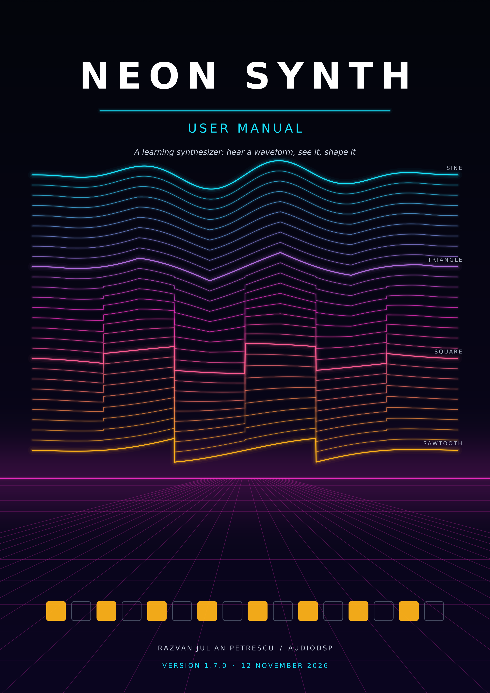
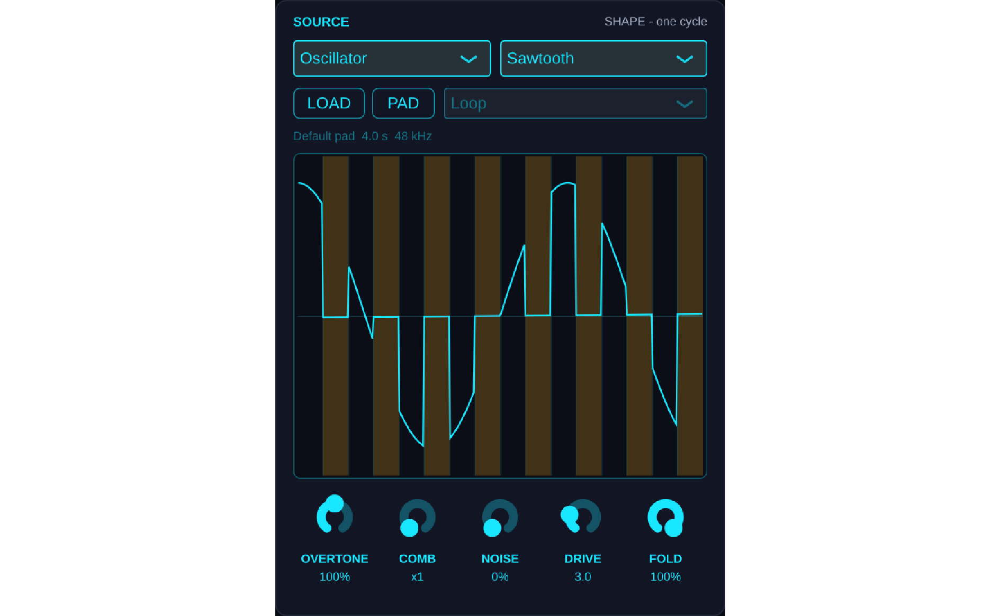
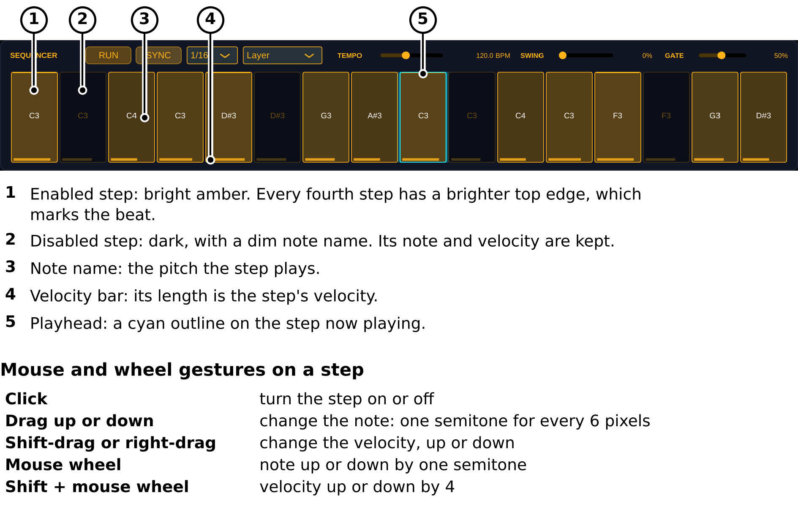

<!-- github-cover: shown on GitHub only; the PDF build draws its own full-page cover and drops this block -->
<p align="center"></p>
<!-- /github-cover -->

# NeonSynth User Manual

NeonSynth is a learning synthesizer: a place to hear what a waveform sounds like, see what changes when you shape it, and explore the code that makes it happen. Its oscillator, sample, random, and granular engines provide different starting points for that exploration, with source code available to read, build, and modify ([NeonSynth project](https://github.com/kv244/Synth)).

For musicians, begin with one note and one waveform, without stacked oscillator layers obscuring what you are hearing. For coders, follow the same sound into the C++ implementation, from waveform generation through envelope, filter, and output; the interface and the code become two views of the same instrument ([voice architecture](https://github.com/kv244/Synth/blob/v1.7.0/NeonSynthVoice.h)).

**Instrument:** NeonSynth by Razvan Julian Petrescu / AudioDSP  
**Edition:** 1.4, updated 12 November 2026 (the new window and its figures; draggable envelope points)<br>
**Applies to:** NeonSynth v1.7.0, source tag `v1.7.0`  
**Formats:** VST3 instrument and standalone application; a Windows installer is supplied for this release ([v1.7.0 release](https://github.com/kv244/Synth/releases/tag/v1.7.0)).

### About this manual

The instructions were checked against the v1.7.0 source code. Every recipe in the sound-design chapter was rendered through the v1.6.0 plugin, to confirm that it sounds, releases cleanly to silence and stays clear of the output soft clipper; v1.7.0 changes only the window, and its sound is checked to be bit-identical to v1.6.0. This is not a certification of compatibility with every audio device or DAW.

Each figure is labelled by how it was made: **Actual application capture** (a screenshot of the running instrument, with numbered callouts added), **Plot derived from rendered audio** (measured from sound the plugin produced, with the settings stated), or **Explanatory schematic** (a drawing that explains an idea and is not a measurement). How to regenerate them is in [figures/README.md](figures/README.md).

The sound-design settings are starting points, not factory presets. Begin at a low listening level and adjust by ear.

## Contents

- [Getting started](#getting-started)
- [Learning by listening](#learning-by-listening)
- [Finding your way around](#finding-your-way-around)
- [Choosing a sound source](#choosing-a-sound-source)
- [Sculpting a waveform](#sculpting-a-waveform)
- [Shaping a sound](#shaping-a-sound)
- [Sample playback](#sample-playback)
- [Granular synthesis](#granular-synthesis)
- [Step sequencer](#step-sequencer)
- [Output and visual feedback](#output-and-visual-feedback)
- [Saving, automation, and MIDI](#saving-automation-and-midi)
- [Sound-design starting points](#sound-design-starting-points)
- [Troubleshooting](#troubleshooting)
- [Learning through the source code](#learning-through-the-source-code)
- [Technical reference](#technical-reference)

## Getting started

### Install the Windows release

Download `NeonSynth-1.7.0-Windows-Setup.exe` from the [v1.7.0 release page](https://github.com/kv244/Synth/releases/tag/v1.7.0). The installer provides the VST3 instrument and an optional standalone application (see [Download](../README.md#download) in the README).

| Component | Default location |
|---|---|
| VST3 instrument | `C:\Program Files\Common Files\VST3\NeonSynth.vst3` |
| Standalone application | `C:\Program Files\AudioDSP\Neon Synth\NeonSynth.exe` |

These are the documented default installation locations; the standalone installation directory can be changed in the installer.

### Make your first sound without a MIDI keyboard

Use this sequence for an uncomplicated standalone check. The built-in sequencer generates the notes, so no external MIDI input is required.

1. Launch `NeonSynth.exe`.
2. Open **Options → Audio/MIDI Settings**.
3. Select your audio output device and enable its output channels.
4. Set **Source** to **Oscillator** and **Waveform** to **Sawtooth**.
5. Leave **GAIN** at 0 dB and begin with your speakers or headphones turned down. A single note peaks around −12 dBFS, and the output soft clipper keeps even 16 loud voices below −1 dBFS, so set the listening level on your monitors rather than with GAIN.
6. Select sequencer mode **Layer**, turn **SYNC** off, and set **TEMPO** to approximately 120 BPM.
7. Press **RUN**.

The factory pattern should now provide a repeating starting point. **RUN** is off on a new instance, so the instrument is initially silent unless it receives MIDI notes; in standalone operation, the sequencer can use its own clock.

Once sound is present, move **Cutoff** to hear the brightness change, then try the other waveforms. Press **RUN** again to stop the pattern; notes already sounding are released rather than held indefinitely.

### Play from a MIDI controller

In standalone mode, enable the controller in **Options → Audio/MIDI Settings**, leave **RUN** off, and play the keyboard. In a DAW, load NeonSynth on an instrument/MIDI track, route the controller to that track, and enable the host's monitoring or record-arm function as required by the host.

The main editor does not provide an on-screen piano keyboard. If you have no hardware controller, use the sequencer or route a virtual MIDI keyboard into the instrument.

### Use NeonSynth in a DAW

Rescan your DAW's VST3 instruments if NeonSynth does not appear after installation, then look for the **AudioDSP** manufacturer. With **SYNC** enabled, press **RUN** in NeonSynth and start the DAW transport to hear its sequence; the **HOST** tempo readout indicates that the host clock is being used (see [VST3](../README.md#vst3) and [Step Sequencer](../README.md#step-sequencer) in the README).

NeonSynth is an instrument, not an effect for processing a live audio input. To use recorded audio as a sound source, load it into the Sample or Granular engine.

## Learning by listening

### One sound source per voice, not one note at a time

In Oscillator mode, each voice starts with one selected waveform, making it straightforward to compare shapes without a second oscillator or layered patch complicating the result. NeonSynth remains polyphonic: it can play up to 16 notes simultaneously; “one source per voice” does not mean “only one note at a time,” and the Granular engine builds its selected source from multiple grains.

The exercises below deliberately use one held note at first. Listen before looking at the display, then use Scope and Spectrum to connect what you hear with what you see.

### Listening exercise: meet the four waveforms

Use the following setup to minimise distractions. This is an educational comparison, not a factory preset or a loudness-calibrated test.

1. Turn **RUN** off and select **Source → Oscillator**.
2. Turn the **FILTER** off, set **WIDTH** to 0%, and leave **GAIN** at 0 dB, with your monitors turned down.
3. Set **ATTACK** to approximately 5 ms, **DECAY** to 100 ms, **SUSTAIN** to 100%, and **RELEASE** to 150 ms.
4. Hold a comfortable mid-range note, such as A4, using a similar playing velocity for each comparison.
5. Compare **Sine**, **Triangle**, **Square**, and **Sawtooth** without changing the note or envelope.
6. Repeat the comparison in **SCOPE**, then in **SPECTRUM**.

If one option sounds louder, lower the listening level rather than treating extra loudness as an improvement; focus on differences in character.

Ask yourself: which sounds smoothest, which feels hollow, and which has the most edge? These are listening prompts, not right-or-wrong labels; the point is to develop your own recognition of each shape.


Figure 2. The four waveforms at A4 (440 Hz). *Plot derived from rendered audio:* each row was rendered through the v1.7.0 plugin at 48 kHz with the settings of the exercise above (ATTACK 5 ms, DECAY 100 ms, SUSTAIN 100%, RELEASE 150 ms, filter off, WIDTH 0%, GAIN 0 dB, velocity 100). The waveform is the first 6.8 ms of the steady note; the spectrum is analysed from 1.0 to 1.5 s with a Blackman-Harris window. All rows share the same scales and none is normalised, so heights are directly comparable. Under each row the figure repeats the listening prompt.

### Listening exercise: hear what a filter removes

Keep the note and envelope unchanged, choose Sawtooth, then enable the filter and slowly move Cutoff down and back up. Switch to Sine and repeat the sweep, observing both the audible change and the spectrum display.

This isolates the relationship between the source and the filter: you are changing one stage while leaving the others alone. Bypass the filter periodically so your ear has an unfiltered reference.

### Listening exercise: separate tone from articulation

Keep one waveform and one cutoff setting, then compare a fast attack with a slow one; next compare short and long releases. Finally, lower Sustain and adjust Decay, listening to how the same source can behave like a pluck or a sustained instrument.

Only after those differences become familiar should you add chords, sequencing, and other source engines. This is a suggested learning order rather than a restriction on the instrument.

## Finding your way around


Figure 1. The main window (v1.7.0 at 150%, Source set to Oscillator, Sawtooth, with the sequencer running). *Actual application capture; the numbered outlines and the key below the picture were added.* Regions 1–9 are explained in the key, and the window is described panel by panel in the table below.

The window has five panels. SOURCE, on the left, is where the sound starts: what plays, and how it is shaped before the envelope. The middle column shows the sound (scope or spectrum) above the envelope and filter. OUTPUT, on the right, sets and measures the level. SEQUENCER runs along the bottom. Colours carry the same meaning everywhere: cyan for the source and output, amber for the envelope and sequencer, and magenta for the filter and the granular controls.

| Panel | What you do there |
|---|---|
| SOURCE | Pick the sound source and waveform. For Sample and Granular, load audio, choose the loop mode, and set the markers on the waveform; for Oscillator and Random, the SHAPE strip and its knobs chop, fold and add noise to the wave. |
| Display | Switch between SCOPE and SPECTRUM to see the mix. |
| ENVELOPE | Set the level shape of each note: drag the points on the graph or turn ATTACK, DECAY, SUSTAIN and RELEASE. |
| FILTER | Switch the low-pass filter in with ON and set its CUTOFF. |
| OUTPUT | Set GAIN and WIDTH, and watch the left and right meters. |
| Header | See which of the 16 voices are sounding, and open the quick help with **?**. |
| SEQUENCER | Start a pattern, edit its steps, and set timing and keyboard interaction. |

### Window size

The window is laid out on a 1280 × 860 grid. It opens at full size (100%) when your screen has room for that plus a title bar, and at 75% otherwise. Drag the resize corner at the bottom right to set any size from 75% to 150%. The proportions stay fixed and everything scales together, text included, so nothing moves or hides as the window changes size. The size is not saved with the session: each time the window opens it chooses again.

Labels are at least 12 pixels at 100%, so they stay readable at 75%. On a small laptop screen, 75% is the comfortable size; on a large monitor, 150% makes the step grid and envelope points easier to grab.

### Quick help

Click **?** for a one-page reference over the whole window. Click anywhere on it, press **Esc**, or click **?** again to return to the controls. Esc works from whichever control you touched last; some DAWs keep keystrokes for themselves until you click inside the plugin window, so click it first if Esc does nothing.

## Choosing a sound source

**Source** selects one of four engines, not four layers mixed together. The selected engine feeds a common envelope, filter, and output path.

| Source | Description | Useful starting applications |
|---|---|---|
| Oscillator | Plays Sine, Square, Triangle, or Sawtooth. | Bass, leads, simple sustained tones. |
| Sample | Plays the loaded recording at pitches determined by MIDI notes and ROOT. | Pitched recordings, looped pads, short sampled sounds. |
| Granular | Builds a cloud of short fragments from the loaded sample. | Frozen textures, moving atmospheres, scattered fragments. |
| Random | Plays a pitched, evolving waveform made from 16 random steps per cycle. | Changing digital tones and animated timbres. |

The applications above are suggested uses rather than built-in patch categories.

### Oscillator waveforms

Select **Oscillator** first, then choose **Sine**, **Square**, **Triangle**, or **Sawtooth** from **Waveform**. The waveform selector is dimmed when another source is selected because it does not choose the waveform of that other engine.

For a first comparison, follow the one-note exercise above with the filter bypassed. Then enable it and repeat the comparison, so you can distinguish the waveform itself from the effect of filtering.

### Random is pitched, not a noise generator

The Random source repeats a 16-step shape at the note's frequency while gradually replacing its step values. Its pitch remains defined while its timbre changes, rather than behaving as an unpitched white-noise source.

### When a source change takes effect

The engine is selected at note-on, so changing **Source** does not immediately convert every held note into the newly selected engine. Release and retrigger notes, or let the sequencer trigger its next steps, to hear the new selection.

## Sculpting a waveform

With **Source** set to **Oscillator** or **Random**, three stages can reshape the wave before it reaches the envelope: **CHOP** cuts or flips parts of every cycle, **NOISE** blends in white noise, and **FOLD** folds the wave back on itself. All three start neutral, so they change nothing until you turn them up. They do not apply to Sample or Granular.



Figure 3. The SOURCE panel with the SHAPE strip: a sawtooth, OVERTONE 100% and FOLD 100% (v1.7.0 at 150%). *Actual application capture.* The shaded steps are chopped, so the wave is cut to the centre line there; the folded curve between them is the sawtooth after FOLD. Every second step is chopped, which is the pattern a new instance starts with.

### The SHAPE strip

While Oscillator or Random is selected, the sample strip becomes the **SHAPE** strip. Its drawing shows one cycle of the wave as it leaves the FOLD stage, with CHOP applied; noise is left out, because a single cycle of noise would mislead more than it shows. The drawing is the ideal shape rather than the exact samples, so the band-limited edges you hear are drawn as clean corners.

The cycle is divided into the steps of CHOP's pattern. A shaded step is chopped; the shading stays faint while OVERTONE is 0%, because chopping then changes nothing.

- **Click a step** to chop it, or to open it again.
- **Drag across steps** to set them all the same way as the first one you clicked.
- With COMB above 1 the pattern repeats along the cycle, so clicking any copy of a step changes every copy.

The pattern is shared by all voices and saved with the session, like the sequencer's steps. It is not a host parameter, and a click cannot be undone; click the step again instead. A new instance, or a session saved before v1.6.0, starts with every second step chopped, so turning up OVERTONE does something straight away.

With Random selected, the drawing follows the 16 levels of the lowest Random note sounding, so you can watch them drift as they are re-rolled. With no Random note sounding it shows a fixed example set.

LOAD, PAD and drag-and-drop still work here, so a sample can be loaded before you switch Source; the sample name and loop selector are dimmed because they don't affect these sources.

### CHOP: OVERTONE and COMB

CHOP is modelled on the OSC CHOP of the Roland S-1. Every cycle is cut into 16 equal steps, and each chopped step is multiplied by 1 − OVERTONE:

| OVERTONE | Chopped steps |
|---|---|
| 0% | Unchanged (the default) |
| 50% | Half as loud |
| 100% | Silent |
| 200% | Turned upside down, at full level |

**COMB** (1–32) repeats the 16-step pattern COMB times within one cycle, so the cuts come faster and the tone turns metallic. A pattern edit or a COMB change takes effect at the start of the next cycle, so it never cuts a cycle in two; OVERTONE glides over 10 ms, so sweeping it doesn't click.

Each cut is band-limited like the oscillator's own edges. At high notes with a high COMB the steps become only a few samples long, too short to cut cleanly, so CHOP fades out instead of aliasing: by about two samples per step it has no effect.

### NOISE

**NOISE** (0–100%) crossfades from the wave to white noise. The crossfade keeps the level steady across the knob: 50% is an even blend, and 100% is noise alone, with no pitch left. The noise follows CHOP, so a chopped step silences the wave but not the noise. Each voice has its own seeded noise, so the same notes render the same audio every time.

### FOLD and DRIVE

**FOLD** (0–100%) mixes in a wavefolder, and **DRIVE** (1–10) sets how hard it folds. The folder is a sine curve: at DRIVE 1 it only flattens the peaks a little, and each step up folds the wave back on itself more times, adding brighter harmonics. FOLD at 0% switches the stage off, so DRIVE then does nothing.

The fold runs at twice the sample rate and is filtered back down, which keeps the new harmonics from folding back below the note as aliasing. A DC blocker follows it, because a chopped or Random wave can fold into a lopsided shape. While FOLD is above 0% the stage delays the sound by about 0.3 ms at 48 kHz, far too little to hear; moving FOLD to or from 0% crossfades over 10 ms rather than clicking.

FOLD comes before the envelope, so a note's timbre stays the same as it fades out.

### Listening exercise: chop, fold, and add noise

Play C3 with the filter bypassed, the spectrum showing, and Source set to Oscillator.

1. **Chop a sawtooth.** Choose Sawtooth and turn OVERTONE from 0% to 100%: every second step falls silent and the spectrum gains a cluster of harmonics around the 8th. Continue to 200%: the chopped steps flip upside down, the fundamental drops away and the tone jumps up, much like a ring modulator.
2. **Comb it.** At OVERTONE 100%, step COMB through 1, 2, 4 and 8. The cuts move up the spectrum and the tone turns bell-like and metallic. Click a few steps to make the pattern uneven and hear the colour change.
3. **Fold a sine.** Return OVERTONE to 0%, choose Sine, set FOLD to 100% and sweep DRIVE from 1 to 10. A sine folds into odd harmonics only (3rd, 5th, 7th …), climbing higher as DRIVE rises, much like a West Coast synthesizer's wavefolder.
4. **Mix in noise.** Set FOLD back to 0% and turn NOISE up slowly. With a little noise the pitch stays clear with a breathy edge; by 100% it is gone.

### Not in this version

Every voice shares one chop pattern; there are no per-voice patterns. Pattern edits can't be undone, the noise is white only, and the three stages do not apply to Sample or Granular.

## Shaping a sound

### Envelope: ATTACK, DECAY, SUSTAIN, RELEASE

The amplitude envelope sets how each note grows, settles, and fades. Attack, Decay, and Release are times; Sustain is a level, not a duration.

| Control | Meaning | Range | Initial value |
|---|---|---|---|
| ATTACK | Time to rise to the attack peak. | 1 ms–5 s | 10 ms |
| DECAY | Time to move from the peak to the sustain level. | 1 ms–5 s | 100 ms |
| SUSTAIN | Level maintained while the note remains held. | 0–100% | 70% |
| RELEASE | Fade time after note release. | 1 ms–10 s | 300 ms |

The initial values are those of a new instance, not settings inherited from a saved session.

For a pluck, try a short attack, a moderate decay, and low sustain; for a pad, try a slower attack and longer release. If a sample ends first, a long envelope cannot create audio beyond the available sample, unless playback is looped.

The envelope graph shows the shape and the positions of sounding voices. It is also a control: drag its four points to set the envelope by eye.

| Point | Drag | Sets |
|---|---|---|
| A, the peak | left or right | ATTACK: further right is a slower attack |
| D, the end of the decay | left or right | DECAY |
| S, the sustain level | up or down | SUSTAIN: the height of the held part |
| R, the end of the release | left or right | RELEASE |

The value appears in the top-right corner of the graph while you drag. Double-click a point to return it to its initial value. Each drag reaches the DAW as one gesture, like turning the knob, so it records cleanly as automation. Dragging the empty part of the graph does nothing. Sustain changes are smoothed, and a note released during Attack or Decay still begins its release from the level it has reached.


Figure 4. The amplitude envelope. *Plot derived from rendered audio:* a sine at A6 was rendered at 48 kHz with ATTACK 300 ms, DECAY 300 ms, SUSTAIN 50% and RELEASE 500 ms, and the plot shows the peak level in each 2 ms frame, scaled so that 1 is the attack peak. Both curves are measured, not drawn: the sustain measures 50.1% and the early release starts from 50.0%. The labels and the dotted key-down and key-up lines were added.

### Low-pass filter

Enable **ON** to use the filter, then lower **Cutoff** to remove more high-frequency content; disable **ON** to bypass it. The cutoff range is 20 Hz–20 kHz, initially 2 kHz, although the engine limits the actual frequency to 45% of the audio sample rate when necessary.

The filter is a two-pole low-pass with fixed Q, not a user-adjustable resonant ladder filter. There is no separate resonance control or dedicated filter envelope in this version.


Figure 5. What the low-pass filter removes. *Plot derived from rendered audio:* a sawtooth at A3 (220 Hz) rendered at 48 kHz, velocity 100, once with the filter bypassed and once with the cutoff at 1 kHz; the same scales are used in every panel and nothing is normalised. The measured attenuation is about 3 dB at the cutoff and about 24 dB at 4 kHz, which is what a two-pole low-pass (12 dB per octave) gives.

## Sample playback


Figure 6. The SOURCE panel with **Source** set to **Sample** (a) and to **Granular** (b), with the built-in pad loaded (v1.7.0 at 150%). *Actual application capture; the numbered outlines and keys were added.* The same strip serves both sources, and the knob row changes with the source. Figure 7 draws what these controls do.

### Load a recording

Click **LOAD**, or drag one WAV, AIFF, or FLAC file onto the window, then select **Source → Sample**. The sample label shows the name, duration, and sample rate; its tooltip exposes the full path when available, and the adjacent status area reports loading problems.

Click **PAD** to restore the built-in sample. This is a four-second pad rooted at MIDI note 60, labelled C4, and provides a ready-made source for both Sample and Granular operation.

### What happens to an imported file

NeonSynth averages the input channels to mono, keeps at most the first 60 seconds, and normalises the resulting sample to a −1 dBFS peak before preparing its internal 24-bit representation. Importing a stereo file therefore does not preserve its original stereo image; stereo output is subsequently created through voice panning.

This processing does not overwrite the original file. Empty or effectively silent input is rejected, including a stereo recording that cancels to silence when its channels are averaged.

### Set the pitch, start, and loop

The Sample control row contains the following parameters. Percentage positions are fractions of the prepared sample's full length.

| Control | Range / initial value | Function |
|---|---|---|
| ROOT | MIDI 0–127 / 60 (C4) | The key that plays the sample at its original playback rate. |
| START | 0–100% / 0% | Where a new note starts reading. |
| L.START | 0–100% / 0% | Beginning of the repeat region. |
| L.END | 0–100% / 100% | End of the repeat region. |
| XFADE | 5–50 ms / 10 ms | Requested crossfade duration at the loop join. |

ROOT tells the instrument how to map the recording; it does not analyse the recording's musical pitch. Set it to match your source, then play above or below it to transpose playback.

Drag the cyan start marker or the amber loop brackets in the waveform display, or use the corresponding knobs. Clicking away from the markers sets the start position, and white lines show the read positions of active Sample voices.

### Choose a loop mode

| Mode | Behaviour |
|---|---|
| One-shot | Reads forward to the end without looping. Note release still invokes the amplitude envelope's Release stage. |
| Loop | Repeats the selected region while the voice sounds, including its release tail. |
| Loop until release | Repeats while the key is held, then exits looping and continues towards the end while the envelope releases. |

These modes control sample playback, not whether the amplitude envelope applies; a short Release can make the sound fade before the file's end is heard.

For a smooth sustained sound, begin with a steady section of the recording and adjust XFADE by ear. Root, start, loop, and crossfade settings are captured when a Sample note begins, so retrigger the note after editing them; an already sounding note continues with its captured settings.

## Granular synthesis

### Build a cloud from the sample

Select **Source → Granular** after loading a recording or restoring **PAD**. The engine plays many short, smoothly windowed fragments of that sample, and the Sample knob row changes to ROOT, POS, SCAN, SIZE, DENS, SPRAY, and JITTER.

| Control | Range | Initial value | What to listen for |
|---|---|---|---|
| ROOT | MIDI 0–127 | 60 (C4) | The sample's pitch reference. |
| POS | 0–100% | 50% | The source region around which fragments are selected. |
| SCAN | −2× to +2× | 0×, frozen | Movement of the grain-selection position through the file. |
| SIZE | 5–500 ms | 80 ms | Short fragments versus longer pieces of the recording. |
| DENS | 1–200 grains/s | 30 grains/s | Sparse events versus overlapping clouds. |
| SPRAY | 0–100% | 10% | How widely fragment positions scatter around the selection position. |
| JITTER | 0–100 cents | 0 cents | Random pitch variation, up to the chosen amount in either direction. |

### Freeze, scan, and scatter

At **SCAN = 0**, the selection position does not advance automatically, but the grains still play and new grains continue to be generated. Positive SCAN moves selection forward through the file; negative SCAN moves it backwards, which is not the same as reversing audio playback inside each grain.


Figure 7. Where Sample and Granular read. *Explanatory schematic:* the positions, the spray range and the grains are example values drawn to explain the controls, not a measurement of a playing voice. The waveform behind panels a and c is real: it is the built-in pad as rendered through the plugin. The crossfade curves are the equal-power cosine and sine curves the loop uses, and the grain is drawn with the window shape the engine applies.

Drag the magenta position marker to explore different regions, then add SPRAY to vary which nearby fragments are chosen. Grain settings shape newly generated grains rather than rewriting fragments already playing, so changes unfold across the cloud instead of replacing it abruptly.

Granular mode uses the sample as a whole rather than the Sample engine's loop region; the loop-mode selector is dimmed in this mode. ROOT is shared with Sample playback, but Sample START, loop boundaries, and XFADE are not granular loop controls.

Each voice supports up to 32 simultaneous grains; further grain onsets are skipped while all slots are busy. The display shows up to eight grain positions per voice, so visible ticks are a guide to activity, not a complete grain counter.

## Step sequencer

### Start and synchronise a pattern

The sequencer repeats a fixed 16-step pattern, with one note, velocity, and enabled/disabled state per step. It generates notes internally for NeonSynth; it is not a MIDI-output sequencer for controlling other instruments.

| Control | Operation |
|---|---|
| RUN | Enables or stops sequencing; initially off. |
| SYNC | Uses the host tempo and transport when the host supplies them; initially on. |
| TEMPO | Internal clock, 40–240 BPM; initially 120 BPM. |
| Rate | 1/8, 1/16, 1/32, 1/8T, or 1/16T; initially 1/16. |
| Mode | Layer, Replace, or Transpose; initially Layer. |
| SWING | 0–100%; delays alternate steps by up to half a step; initially 0%. |
| GATE | 5–100% of the nominal step duration; initially 50%. |

When **SYNC** is enabled in a compatible DAW, the sequence follows the host's transport position and stops when the host stops. In standalone operation, or when no usable host timing is available, it uses TEMPO instead; turning SYNC off explicitly selects the internal clock.

For a straightforward 16-step loop in 4/4, begin with **1/16**, zero swing, and a 50% gate. The **T** rate options provide triplet subdivisions; reducing GATE shortens the interval before note-off, but a long envelope release can still make successive notes overlap.

### Edit the step grid

| Gesture | Result |
|---|---|
| Click a step | Switches it on or off. |
| Drag up or down | Changes pitch in semitone steps. |
| Shift-drag or right-drag | Changes velocity. |
| Mouse wheel | Raises or lowers pitch by one semitone per wheel event. |
| Shift + mouse wheel | Changes velocity in increments of four. |

The grid supports MIDI notes 0–127 and enabled-step velocities 1–127; the cyan outline marks the current step, and each cell's lower bar indicates its velocity.



Figure 8. The step grid (v1.7.0 at 150%, sequencer running). *Actual application capture; the numbered pointers and the gesture key were added.* The gestures are those in the table above, as coded in the step view: one semitone for every 6 pixels of vertical drag, velocity changes of one for each pixel of Shift-drag or right-drag, and steps of four for Shift with the wheel.

To create a new pattern, first switch unwanted steps off, drag the remaining steps to their pitches, and adjust their velocities for accents. There is no separate pattern-bank or pattern-length control in this version.

### Choose how the keyboard interacts

- **Layer:** Keyboard notes play alongside the pattern.
- **Replace:** The running sequencer supplies notes; incoming keyboard note-ons do not play additional notes.
- **Transpose:** Hold a key to trigger the pattern at an offset relative to MIDI note 60, labelled C4; the most recently pressed held key determines the offset.

These behaviours apply while RUN is on; with the sequencer off, keyboard note input plays normally. In Transpose mode, hold C4 for the unshifted pattern, C5 for an octave up, or C3 for an octave down, remembering that some hosts use different octave names for the same MIDI note numbers.

If RUN is lit but Transpose mode is silent, hold a key and, with host synchronisation active, start the DAW transport. This mode intentionally waits for keyboard input rather than free-running independently.

## Output and visual feedback

### Gain and stereo width

**GAIN** controls output level from −48 dB to +6 dB, initially 0 dB; **WIDTH** controls pitch-based voice placement from 0% to 100%, initially 60%. At zero width, voices are centred; increasing width places notes below C4 towards the left and notes above C4 towards the right, reaching the extremes two octaves either side at full width.

WIDTH is not chorus, delay, or a stereo image restored from an imported recording. A single C4 note remains centred even at full width, so try notes on either side of it or a chord when evaluating the control.

### Scope, spectrum, voices, and meters

- **SCOPE:** Displays the output waveform and uses the lowest active note as its pitch reference.
- **SPECTRUM:** Displays frequency content with the filter-response curve.
- **VOICES:** Provides one light per voice, with brightness following its envelope.
- **Envelope graph:** Shows the note shape with moving voice-position dots.
- **L/R meter:** Shows output levels, peak hold, and a clip indicator; click to reset the meter.

The scope and spectrum show the stereo mid signal, `(L + R) / 2`, rather than separate left/right traces.

The output soft clipper leaves signals below −6 dBFS unchanged and constrains peaks to below approximately −1 dBFS. Its indicator signals peak shaping, not a guarantee against clipping later in the DAW chain or excessive listening volume; lower GAIN when you want less peak shaping.

## Saving, automation, and MIDI

### Save the sound and pattern

In a DAW, save your project or use the host's plugin-state/preset facilities to retain NeonSynth's settings. Its saved state includes the parameters, the 16-step pattern, CHOP's pattern, the selected Scope/Spectrum view, and sample information; individual step values are saved state rather than separate automatable host parameters.

The custom editor has no dedicated patch browser or Save Patch button. Use the host's facilities where available, and verify a saved project by closing and reopening it before relying on it for an important session.

### Keep sample-based sessions portable

Custom samples are stored inside the plugin state as prepared mono 24-bit FLAC when the encoded payload is no larger than 10 MiB. Larger samples, or samples whose embedded encoding is unavailable, depend on their saved file path instead.

On restoration, NeonSynth tries the embedded audio first, then the saved path; if neither can be loaded, it uses the built-in pad and retains the missing-file reference. Hearing a pad instead of your recording can therefore indicate a missing sample rather than a lost pattern or envelope setting.

For dependable archiving, keep original samples with the DAW project even when embedding appears to work. For a missing recording, load the intended file again, retrigger notes, and resave the session.

### Automate controls

Use the DAW's automation facilities for the exposed parameters, including source, waveform, envelope, cutoff, output controls, sample settings, granular settings, the five sculpting knobs, and sequencer timing/mode controls. The Scope/Spectrum choice, individual sequencer steps and CHOP's steps are not independent automation parameters.

Automation follows each control's playback semantics: a source or Sample-loop change takes effect at a subsequent note, while granular changes shape newly generated grains. Do not expect every automated change to rewrite audio already sounding.

### MIDI scope and limitations

NeonSynth responds to MIDI note pitch and velocity, with up to 16 simultaneous voices and voice stealing when that pool is occupied. Incoming keyboard channels are consolidated internally so keyboard notes and sequencer notes do not cut each other off solely because they share a pitch.

Pitch-wheel and general controller callbacks do not provide voice-level modulation in this version, so do not expect pitch bend or the modulation wheel to alter the sound. There is no dedicated MIDI-learn interface or external MIDI-output function exposed by the instrument.

## Sound-design starting points

These are suggested manual settings, not supplied factory presets. Each was rendered through NeonSynth v1.6.0 with GAIN at 0 dB: all of them peak between about −20 and −10 dBFS, below the point where the output soft clipper starts to act, so leave GAIN at 0 dB, keep your monitors modest, and adjust each sound to the recording, notes, and mix you are using.

### Rounded sequencer bass

- **Source:** Oscillator; Waveform: Sawtooth.
- **Envelope:** ATTACK 5 ms, DECAY 180 ms, SUSTAIN 35%, RELEASE 100 ms.
- **Filter:** On; Cutoff approximately 700 Hz.
- **Output:** WIDTH 0%.
- **Sequencer:** Layer, 1/16, GATE 40%; start with the default pattern.

Try raising Cutoff gradually while the pattern runs, then compare Square with Sawtooth. For a softer phrase, increase Release slightly before increasing Gate.

### Slow sampled pad

- **Source:** Sample; press PAD and set ROOT to C4.
- **Loop:** Loop; START 0%, L.START approximately 25%, L.END approximately 75%, XFADE 20 ms.
- **Envelope:** ATTACK 800 ms, DECAY 600 ms, SUSTAIN 75%, RELEASE 2 s.
- **Filter:** On; Cutoff approximately 3 kHz.
- **Output:** WIDTH 70%; RUN off.

Play a chord and hold it long enough to hear the sustain region, then release it. Retrigger the notes after changing the loop boundaries.

### Frozen granular texture

- **Source:** Granular; begin with PAD or a short textured recording.
- **Cloud:** POS 50%, SCAN 0, SIZE 150 ms, DENS 35/s, SPRAY 10%, JITTER 5 cents.
- **Envelope:** ATTACK 500 ms, DECAY 300 ms, SUSTAIN 80%, RELEASE 2 s.
- **Filter:** On; Cutoff approximately 4 kHz.

Hold a note and move POS slowly to explore the recording. Keep SCAN at zero initially so you can hear position changes without automatic movement. A single held note is the quietest of these recipes, about 8 dB below the others; play a chord or raise GAIN if you need more level.

### Moving granular atmosphere

- **Source:** Granular; load a recording with contrasting sections.
- **Cloud:** POS 20%, SCAN +0.20×, SIZE 100 ms, DENS 45/s, SPRAY 25%, JITTER 12 cents.
- **Envelope:** ATTACK 300 ms, DECAY 500 ms, SUSTAIN 70%, RELEASE 1.5 s.
- **Output:** WIDTH approximately 60%; RUN off.

Try a negative SCAN value to move selection backwards through the recording, then reduce DENS for a more fragmented texture. Reduce the number of held notes if the processing load becomes excessive.

### Evolving random pluck

- **Source:** Random.
- **Envelope:** ATTACK 3 ms, DECAY 250 ms, SUSTAIN 0%, RELEASE 120 ms.
- **Filter:** On; Cutoff approximately 2.5 kHz.
- **Sequencer:** 1/8 or 1/16; GATE 35%; a few velocity accents.

Let the pattern repeat before deciding how much variation you want. Try opening the filter for more of the waveform's changing character.

### Chopped, folded lead

- **Source:** Oscillator; Waveform: Sawtooth.
- **Shape:** OVERTONE 100%, COMB 2, the default pattern (every second step chopped); NOISE 5%; DRIVE 3, FOLD 50%.
- **Envelope:** ATTACK 5 ms, DECAY 300 ms, SUSTAIN 60%, RELEASE 200 ms.
- **Filter:** On; Cutoff approximately 6 kHz.
- **Output:** WIDTH 30%.

Play a single-note melody around C4. Click steps open or closed in the SHAPE strip while you play to hear the colour change, then try OVERTONE 200% for a harder, ring-modulated edge.

## Troubleshooting

### No sound

Work through the signal path rather than changing several settings at once. In standalone mode, confirm the output device and enabled channels; in a DAW, confirm the instrument track, monitoring, and MIDI routing.

- **No voice lights:** Check that MIDI notes are arriving, or select Layer, turn SYNC off, and press RUN for an internal-clock test.
- **RUN on but silent:** Check for Transpose mode waiting for a held key, or SYNC waiting for the DAW transport.
- **Voice lights but little output:** Raise Cutoff, check GAIN, and check for a very slow Attack or zero Sustain after the decay has completed.
- **Very low notes barely audible:** Try a higher octave or Sawtooth/Square instead of Sine/Triangle, particularly on laptop speakers.

### A control seems to do nothing

- **Waveform dimmed:** Select Oscillator; it does not change Sample, Granular, or Random.
- **Cutoff dimmed:** Enable the filter.
- **Loop selector dimmed:** You are using Granular, whose controls do not use the Sample loop mode.
- **Source or loop edits not heard:** Release and retrigger the note.
- **WIDTH not obvious:** Try a chord spanning notes below and above C4.
- **OVERTONE has no effect:** No steps are chopped; click some steps in the SHAPE strip.
- **DRIVE has no effect:** FOLD is at 0%, which switches the folder off.
- **SHAPE knobs have no effect:** They act on Oscillator and Random only.
- **Pitch/modulation wheel has no effect:** These are not implemented as voice modulation controls.

These are expected behaviours, not faults.

### Sample sounds different or will not load

Import processing folds channels to mono, normalises the peak, and limits duration to 60 seconds; this can explain a changed stereo image, changed level, or shortened recording. Check the displayed status, try a supported WAV/AIFF/FLAC file with clearly audible content, and check the source file's mono compatibility if stereo cancellation is suspected.

If a reopened project plays the default pad, reload the intended file and save the project again. A missing external sample can cause the engine to fall back to the pad when no usable embedded copy is available.

### Notes overlap, cut short, or sound distorted

A long Release can overlap several sequencer steps, while a very short Release can fade out a one-shot sample before it reaches its end. More than 16 occupied voices requires voice stealing, and high combined levels can engage the output soft clipper.

Try shortening Release, reducing the number of simultaneous notes, or lowering GAIN. When shaping a sampled sustain, select a steady loop region and compare different crossfade settings before assuming the recording itself is unsuitable.

### Crackles or dropouts

As a troubleshooting approach, increase the audio buffer size, reduce the number of held notes and granular density/size, and compare with a single Oscillator voice. Heavy granular settings can keep many grains active in every voice; the repository's benchmark figures are development-machine measurements, not a performance guarantee for your system.

### NeonSynth is missing from the DAW

Check the VST3 installation location and run the DAW's plugin rescan. This release is configured for VST3 and Standalone, not AU, AAX, or VST2; before version 1.4 it was called BasicSynth, and the installer removes the old BasicSynth VST3 bundle to prevent duplicate listings.

## Learning through the source code

### An instrument you can inspect

The source is available in the public [NeonSynth repository](https://github.com/kv244/Synth), alongside the build instructions, tests, and support utilities. Treat the instrument as an executable explanation: hear a change, find its control in the code, and trace how its value affects the samples being produced.

You do not need to understand the whole application before investigating one part. Start with the relationship between a single waveform and a single voice, then work outwards towards polyphony, sample playback, and the sequencer.

### A guided reading path

| Start here | What to look for | Connect it to the instrument |
|---|---|---|
| `Oscillator.h` | Waveform generation, phase, band-limiting, and CHOP. | Compare Sine, Triangle, Square, and Sawtooth on the same note. |
| `Sculpt.h` / `ShapeView.h` | Noise, the oversampled wavefolder, and the SHAPE strip's drawing. | Sweep DRIVE while watching the drawing and the spectrum. |
| `VoiceEnvelope.h` | Envelope stages and their time/level behaviour. | Move ATTACK, DECAY, SUSTAIN, and RELEASE while watching the graph. |
| `NeonSynthVoice.h` | One note's source, envelope, filter, and panning. | Follow a note from source generation to stereo placement. |
| `NeonSynthProcessor.cpp` | Parameter ranges/defaults, MIDI routing, output processing, and state. | Match a displayed control to its stored value and playback effect. |
| `SampleData.h` / `SampleLoader.h` | File preparation, mono conversion, normalisation, and embedded audio. | Compare an imported recording with its prepared sample. |
| `SampleReader.h` | Pitch mapping and crossfaded loop playback. | Investigate ROOT, loop boundaries, and XFADE. |
| `GrainCloud.h` | Grain scheduling, windows, scan positions, and SIMD paths. | Connect SIZE, DENS, and SCAN to individual fragments. |
| `StepSequencer.h` / `SequencerView.h` | Timing engine versus editable grid. | See how a visual step becomes a timed note event. |
| `Visualisers.h` / `NeonSynthEditor.h` | Display processing and control attachments. | Understand how sound and parameter state reach the screen. |
| `tests/` | Focused engine tests and the render benchmark. | Read the expected behaviour before changing its implementation. |

It is an editorial guide, not a requirement to read every file in this order.

### Make a small change, then test it

A useful first experiment is to change a default envelope time in `createParameterLayout()`, rebuild, and open a fresh instance to hear the result. Existing saved sessions can restore their own settings, so they are not a reliable way to check that a new default has taken effect ([parameter definitions and state restoration](https://github.com/kv244/Synth/blob/v1.7.0/NeonSynthProcessor.cpp)).

For a deeper exercise, inspect why a waveform change waits for a cycle boundary or how grain size and density affect overlap. Make one change at a time, work on a branch, and run the relevant tests before comparing the result with the original; the README's [Unit tests and benchmark](../README.md#unit-tests-and-benchmark) section lists what each test checks.

Source availability is an invitation to inspect and experiment, not a promise that every edit is safe for real-time audio. In particular, avoid adding file I/O, blocking work, or heap allocation to the audio callback; the project includes a real-time-safety test specifically checking rendering-time allocation/deallocation.

### Working with AI coding tools

Use AI assistance to ask focused questions about an existing function, propose a small change, or help explain a failing test. Keep responsibility for the result: compare the answer with the actual implementation, compile it, test it, and listen at a safe level rather than assuming plausible code will produce correct audio.

The project identifies Claude-assisted development, but Claude is not a runtime requirement for playing the instrument. Build dependencies are described under [Building](../README.md#building) in the README.

## Technical reference

### Signal path

The voice engine places its amplitude envelope before the low-pass filter and panner; voices are then summed, followed by output gain and soft clipping. This is the implemented path, rather than a generic synthesis diagram ([voice engine](https://github.com/kv244/Synth/blob/v1.7.0/NeonSynthVoice.h), [processor](https://github.com/kv244/Synth/blob/v1.7.0/NeonSynthProcessor.cpp)).

```text
MIDI keyboard / DAW notes ─┐
                          ├─> voice allocation, up to 16 voices
Internal step sequencer ──┘

Per voice:
selected source → (Oscillator and Random only: CHOP → noise → fold) → amplitude envelope → low-pass filter/bypass → pitch-based pan

Combined output:
voice sum → output gain → soft clipper → mono/stereo output and visualisers
```

### Behaviour worth remembering

| Feature | Implementation detail |
|---|---|
| Source changes | Selected when a note starts. |
| Sample playback settings | Captured when a note starts. |
| Granular settings | Shape subsequent grains; position remains live. |
| Oscillator waveform changes | Applied at a cycle boundary. |
| CHOP pattern and COMB | Applied at a cycle boundary; OVERTONE glides over 10 ms. |
| Filter cutoff, gain, and panning | Smoothed to reduce abrupt changes. |
| Sequencer events | Scheduled at sample offsets and rendered at their MIDI event positions. |
| Random / granular variation | Seeded for reproducible renders from the same reset state and event sequence. |
| Imported sample audio | Prepared mono audio; original file is not modified. |

These details follow the [voice engine](https://github.com/kv244/Synth/blob/v1.7.0/NeonSynthVoice.h), [processor](https://github.com/kv244/Synth/blob/v1.7.0/NeonSynthProcessor.cpp), [grain engine](https://github.com/kv244/Synth/blob/v1.7.0/GrainCloud.h), and [sample preparation](https://github.com/kv244/Synth/blob/v1.7.0/SampleData.h).

### Optional MIDI diagnostics

Launch the standalone application with `--midilog`, or set `NEONSYNTH_MIDILOG` before starting a host, to log received MIDI messages. Use an absolute path to avoid uncertainty about the working directory; logging is a diagnostic facility, not an audio recorder (see [MIDI Logging](../README.md#midi-logging) in the README).

```powershell
& "C:\Program Files\AudioDSP\Neon Synth\NeonSynth.exe" --midilog "C:\Users\YourName\Documents\NeonSynth-midi.log"
```

The included `log_to_midi.py` utility converts a captured text log into a MIDI file, while `test_midi.py` can render demonstration audio when its optional dependencies are installed. These are developer/support tools rather than controls in the instrument editor.

### Building from source

The repository specifies C++17, CMake 3.21 or newer, and a separately supplied JUCE checkout; its current README identifies JUCE 9.0.0. Follow the [build instructions](../README.md#building) when setting up your development environment.

```bash
cmake -S . -B build -DJUCE_DIR="/path/to/JUCE" -DCMAKE_BUILD_TYPE=Release
cmake --build build --config Release
```

Use the repository's build instructions for platform dependencies and optional tests. The supplied Windows release should not be taken as evidence that prebuilt macOS or Linux installers are available.

### Reporting a reproducible problem

Record the application version, operating system, standalone/DAW context, audio sample rate and buffer size, selected source, RUN/SYNC/mode settings, and a short sequence of actions that reproduces the issue. For sample problems, include the file format, length, channel count, displayed status message, and whether it fails on first load or after reopening a saved session.

Keep a copy of the project and source sample before experimenting with a workaround. A small reproducible example is more useful than a screenshot of unexplained silence.

<p class="fineprint"><strong>Fine print.</strong> NeonSynth is free software: you can redistribute it and/or modify it under the terms of the GNU Affero General Public License, version 3 (<a href="../LICENSE">LICENSE</a>). The software and this manual are provided “as is”, without warranty of any kind, express or implied, including but not limited to the warranties of merchantability, fitness for a particular purpose and non-infringement. The entire risk as to the quality and performance of the software is with you. In no event shall the author or copyright holders be liable for any claim, damages or other liability, including loss of data, damage to equipment or hearing, or any other loss, arising from the use of or inability to use the software, even if advised of the possibility of such damages. Audio software can produce sudden loud sounds: keep monitoring levels low while experimenting.</p>
